# Projeto - Cidades ESG Inteligentes

[](https://github.com/JotaDiasDevs/gaiaops-esg/actions/workflows/ci-cd.yml)

**GaiaOps ESG**: API de gestão ESG para cidades inteligentes, com pipeline completo de CI/CD.
FIAP · Fase *Navegando pelo mundo DevOps*

| Integrante | RM |
|---|---|
| João Victor Semente Dias | RM562065 |

---

## Sobre o projeto

O GaiaOps é a plataforma de gestão ESG do município fictício de **Vila Nova do Horizonte**. O município tem cerca de 90 mil habitantes, distribuídos em quatro distritos. O projeto nasceu na Fase 5 (*Um novo paradigma com NOT ONLY SQL*) como uma base MongoDB com cinco collections:

| Collection | Pilar | Conteúdo |
|---|---|---|
| `equipamentos` | G | Escolas, UBS, praças, ETEs, ecopontos, iluminação pública e terminais |
| `medicoes` | E | Telemetria IoT: qualidade do ar, ruído, energia, água, tráfego e hidrologia |
| `residuos` | E / S | Coleta seletiva, cooperativas e destinação final |
| `programas_sociais` | S | Políticas públicas e beneficiários (pseudonimizados, LGPD) |
| `conformidade` | G | Licenças, audiências públicas, conselhos, ouvidoria e TACs |

Nesta fase, a base virou uma **aplicação Java Spring Boot** em ambiente de produção simulado:

- **API REST** com CRUD de equipamentos, ingestão de medições com **alertas automáticos** (IQAr, ruído, perdas de água e nível de córregos), consultas e um **painel ESG** calculado por agregações no MongoDB;
- **mesmos validadores `$jsonSchema` e índices** da Fase 5, aplicados automaticamente no container do banco;
- **carga inicial** com os 100 documentos reais da Fase 5;
- **containerização** com Docker e orquestração com Docker Compose;
- **pipeline CI/CD** no GitHub Actions, com build, testes, publicação da imagem e deploy em **staging** e **produção**.

### Arquitetura

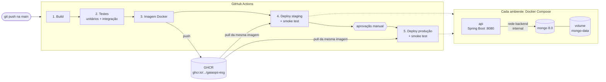

---

## Como executar localmente com Docker

**Pré-requisito:** [Docker Desktop](https://www.docker.com/products/docker-desktop/) (ou Docker Engine + Compose v2).

```bash
# 1. Clone o repositório
git clone https://github.com/JotaDiasDevs/gaiaops-esg.git
cd gaiaops-esg

# 2. Crie o arquivo de variáveis a partir do exemplo (e troque as senhas)
cp .env.example .env

# 3. Construa a imagem e suba API + MongoDB
docker compose up -d --build

# 4. Acompanhe até os dois serviços ficarem "healthy"
docker compose ps
```

Depois de subir, acesse:

| URL | O que é |
|---|---|
| http://localhost:8080 | Página inicial: ambiente, versão, commit e painel ESG ao vivo |
| http://localhost:8080/swagger-ui.html | Documentação interativa da API (Swagger UI) |
| http://localhost:8080/api/indicadores | Painel ESG em JSON |
| http://localhost:8080/actuator/health | Saúde da aplicação e do MongoDB |

Comandos úteis:

```bash
docker compose logs -f api                                # log da API
docker compose exec mongo mongosh -u admin -p --authenticationDatabase admin gaiaops_esg   # shell do banco
docker compose down                                       # para tudo (os dados ficam no volume)
docker compose down -v                                    # para tudo e apaga o volume (reinicia do zero)
```

### Subir staging e produção na mesma máquina

Os ambientes do pipeline também podem ser recriados localmente com os mesmos scripts. Cada um vira um projeto Compose isolado, com containers, rede e volume próprios:

```bash
./deploy/deploy.sh staging        # http://localhost:8081
./deploy/smoke-test.sh staging

./deploy/deploy.sh production     # http://localhost:8082
./deploy/smoke-test.sh production
```

> No Windows, rode os scripts pelo **Git Bash**. Sem `API_IMAGE` definida, o `deploy.sh` constrói a imagem localmente. As senhas são geradas na primeira execução e ficam em `deploy/.segredos-<ambiente>.env`, arquivo fora do Git.

### Sem Docker (desenvolvimento)

Com um MongoDB rodando em `localhost:27017`, basta `./mvnw spring-boot:run`. A API cria e popula o banco `gaiaops_esg_api`.

---

## Pipeline CI/CD

**Ferramenta:** GitHub Actions, definido em [`.github/workflows/ci-cd.yml`](.github/workflows/ci-cd.yml).
**Registry de imagens:** GitHub Container Registry (GHCR).

| # | Job | O que faz | Quando roda |
|---|---|---|---|
| 1 | **Build** | Compila com Maven (Java 21), empacota o `.jar` e o publica como artefato | push e pull request |
| 2 | **Testes automatizados** | `mvn verify`: 16 testes unitários (JUnit 5 + MockMvc) e 6 de integração com **MongoDB real** via Testcontainers; publica relatórios e a cobertura (JaCoCo) | push e pull request |
| 3 | **Imagem Docker** | Constrói a imagem pelo `Dockerfile` (com cache de camadas) e publica no GHCR com a tag do commit e `latest` | push na `main` |
| 4 | **Deploy staging** | `deploy/deploy.sh staging`: baixa a imagem e sobe API + MongoDB com Docker Compose, roda o **smoke test** (8 verificações), tira print da página, coleta logs e marca a imagem como `staging` | após o job 3 |
| 5 | **Deploy produção** | Aguarda **aprovação manual** e repete o deploy com a **mesma imagem** e a configuração de produção; marca a imagem como `production` | após aprovação |

### Lógica do pipeline

- **Cada etapa depende da anterior.** Teste quebrado não vira imagem. Imagem que falha no smoke test de staging não chega à produção.
- **Build once, deploy many.** A imagem é construída **uma única vez** (job 3), e staging e produção recebem exatamente a mesma, identificada pelo hash do commit. O que muda entre ambientes é só configuração (`deploy/staging.env` e `deploy/production.env`).
- **Pull requests** rodam apenas build e testes, o que valida a mudança antes do merge.
- **Aprovação manual para produção:** o job 5 usa o *environment* `production` do GitHub, configurado com *required reviewers*.
- **Smoke test** ([`deploy/smoke-test.sh`](deploy/smoke-test.sh)): confere readiness (aplicação + MongoDB), ambiente e commit corretos em `/actuator/info`, painel ESG, carga inicial, validação de entrada (HTTP 400) e a configuração específica do ambiente (Swagger ligado em staging e desligado em produção). Qualquer falha interrompe o pipeline.
- **Segredos:** as senhas do MongoDB nunca ficam no repositório. Elas vêm dos **GitHub Secrets** de cada environment ou, se não forem cadastradas, são geradas aleatoriamente no deploy e mascaradas no log.
- **Evidências automáticas:** cada deploy publica o artefato `evidencias-<ambiente>`, com as respostas da API, um print da página inicial (Chrome headless), o estado dos containers e os logs. O Job Summary de cada execução mostra o resultado dos testes e do smoke test.

### Diferenças entre os ambientes

| | Staging | Produção |
|---|---|---|
| Perfil Spring | `staging` | `prod` |
| Porta | 8081 | 8082 |
| Swagger UI | habilitado | **desabilitado** |
| `/actuator/health` | com detalhes (Mongo, readiness) | só `UP`/`DOWN` |
| Log da aplicação | `DEBUG` | `INFO` |
| Memória da API | 768 MB | 1 GB |
| Aprovação para deploy | automática | **manual** |

### Onde os ambientes rodam

Por padrão, os jobs de deploy rodam nos **runners hospedados do GitHub**: máquinas Linux com Docker que o GitHub cria para cada job e descarta ao final. O deploy é real: a imagem publicada é baixada, os containers sobem, os testes de fumaça passam e as evidências ficam salvas. Os ambientes, porém, existem só durante o job.

Para ambientes **persistentes**, basta registrar um *self-hosted runner* (uma VM ou máquina Linux com Docker) e criar a variável de repositório `DEPLOY_RUNNER` com o label dele. Os jobs de deploy passam a rodar nessa máquina, e staging e produção ficam no ar nas portas 8081 e 8082, sem mudar nenhum script.

### Configuração no GitHub (uma vez)

1. **Settings → Environments → New environment**: crie `staging` e `production`.
2. Em `production`, marque **Required reviewers** e adicione você mesmo. Isso cria o portão de aprovação manual.
3. *(Opcional)* Em cada environment, cadastre os secrets `MONGO_ROOT_PASSWORD` e `MONGO_APP_PASSWORD` (só letras e números).
4. *(Opcional)* **Settings → Secrets and variables → Actions → Variables**: crie `DEPLOY_RUNNER` para usar um self-hosted runner.

---

## Containerização

### Dockerfile

```dockerfile
# syntax=docker/dockerfile:1
# ---------- Estágio 1: build ----------
FROM maven:3.9-eclipse-temurin-21 AS build
WORKDIR /workspace

COPY pom.xml .
RUN mvn -B -ntp dependency:go-offline

COPY src ./src
RUN mvn -B -ntp package -DskipTests

# ---------- Estágio 2: runtime ----------
FROM eclipse-temurin:21-jre-alpine AS runtime

LABEL org.opencontainers.image.title="GaiaOps ESG API" \
      org.opencontainers.image.description="API de gestao ESG para Cidades Inteligentes"

RUN addgroup -S -g 10001 gaiaops && adduser -S -u 10001 -G gaiaops gaiaops

WORKDIR /app
COPY --from=build --chown=10001:10001 /workspace/target/gaiaops-esg.jar app.jar

USER 10001:10001
EXPOSE 8080

ENV JAVA_TOOL_OPTIONS="-XX:MaxRAMPercentage=75 -XX:+ExitOnOutOfMemoryError"

HEALTHCHECK --interval=10s --timeout=5s --start-period=40s --retries=5 \
  CMD ["sh", "-c", "wget -q -O /dev/null http://localhost:8080/actuator/health/readiness || exit 1"]

ENTRYPOINT ["java", "-jar", "/app/app.jar"]
```

O arquivo completo, comentado linha a linha, está em [`Dockerfile`](Dockerfile).

### Estratégias adotadas

| Estratégia | Por quê |
|---|---|
| **Multi-stage build** | A imagem final leva só o JRE e o `.jar`. Maven, JDK e código-fonte ficam no estágio de build. |
| **Camada de dependências separada** | `pom.xml` é copiado e resolvido antes do código. Mudar só o código reaproveita o cache e não baixa as dependências de novo. No pipeline, o cache vai para o GitHub Actions (`cache-to: type=gha`). |
| **Base `eclipse-temurin:21-jre-alpine`** | Runtime Java mínimo e mantido, com menos pacotes e menos vulnerabilidades. |
| **Usuário sem privilégios (UID 10001)** | O processo não roda como root dentro do container. |
| **JVM ciente do container** | `MaxRAMPercentage=75` dimensiona o heap pelo limite de memória do container, e `ExitOnOutOfMemoryError` deixa o Docker reiniciar um processo doente. |
| **`HEALTHCHECK` no readiness** | O container só fica *healthy* quando a API está pronta **e** o MongoDB responde. O `docker compose up --wait` e o deploy dependem disso. |
| **`ENTRYPOINT` em formato exec** | A JVM é o PID 1 e recebe o `SIGTERM` direto, o que garante o encerramento gracioso (`server.shutdown=graceful`). |
| **`.dockerignore`** | Só `pom.xml` e `src/` entram no contexto de build. `.env`, `target/` e `.git/` ficam de fora. |

### Orquestração ([`docker-compose.yml`](docker-compose.yml))

| Recurso | Uso |
|---|---|
| **Serviços** | `mongo` (MongoDB 8.0) e `api` (imagem deste projeto). A API só inicia quando o Mongo está *healthy* (`depends_on: condition: service_healthy`). |
| **Volume** | `mongo-data` mantém os dados entre reinícios e novos deploys. |
| **Script de init** | `mongo/init/01-setup.js` roda na criação do volume e cria as collections com validadores `$jsonSchema`, os índices da Fase 5 e um **usuário da aplicação com permissão só no banco dela** (menor privilégio). |
| **Redes** | `frontend` (a API publica a porta) e `backend` (`internal: true`, só API ↔ Mongo). **O banco não expõe porta** para fora do Docker. |
| **Variáveis de ambiente** | Tudo que muda entre ambientes vem do `.env` ou do `deploy/<ambiente>.env`: porta, perfil Spring, nome do ambiente, imagem, limite de memória e credenciais. Senhas obrigatórias usam `${VAR:?}`, então o Compose se recusa a subir sem elas. |
| **Limite de recursos** | `deploy.resources.limits.memory` limita a memória da API por ambiente. |

---

## Prints do funcionamento

> As capturas ficam em [`docs/prints/`](docs/prints/). O roteiro completo está em [`docs/ROTEIRO-PRINTS.md`](docs/ROTEIRO-PRINTS.md).

### Pipeline: visão geral (build → testes → imagem → staging → produção)
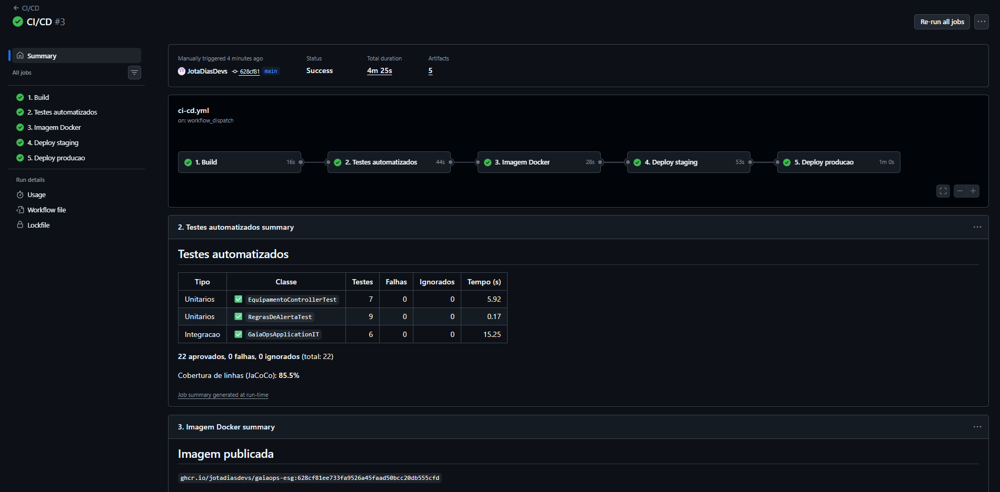

### Build
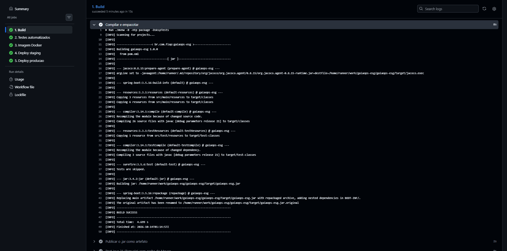

### Testes automatizados (unitários + integração com MongoDB)
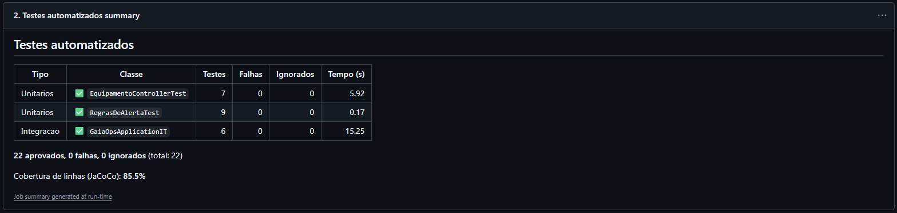

### Deploy em staging com smoke test
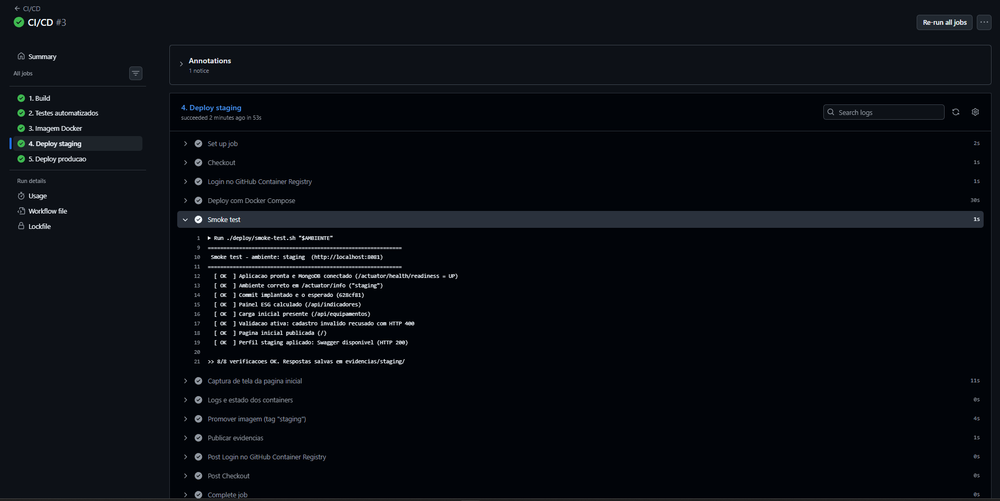

### Aprovação manual e deploy em produção
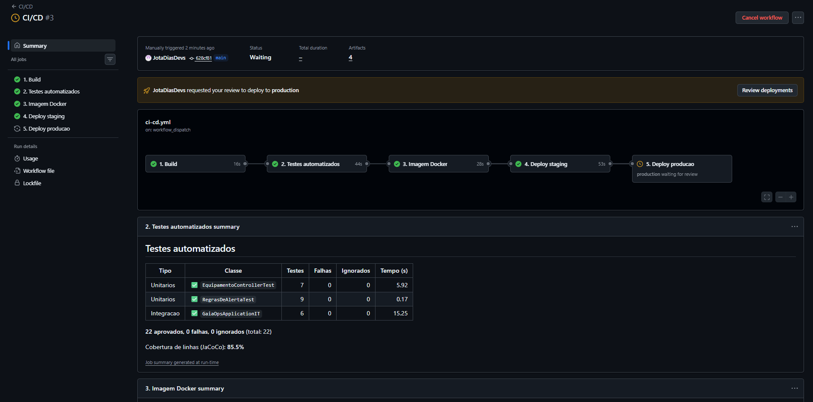
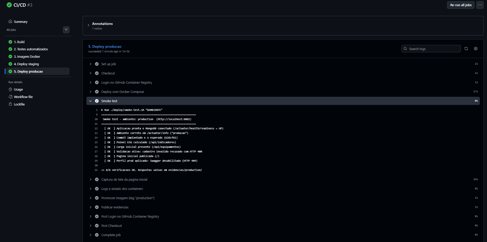

### Ambiente de staging funcionando
Print gerado pelo próprio pipeline (Chrome headless) logo após o smoke test: faixa laranja de staging e commit implantado.
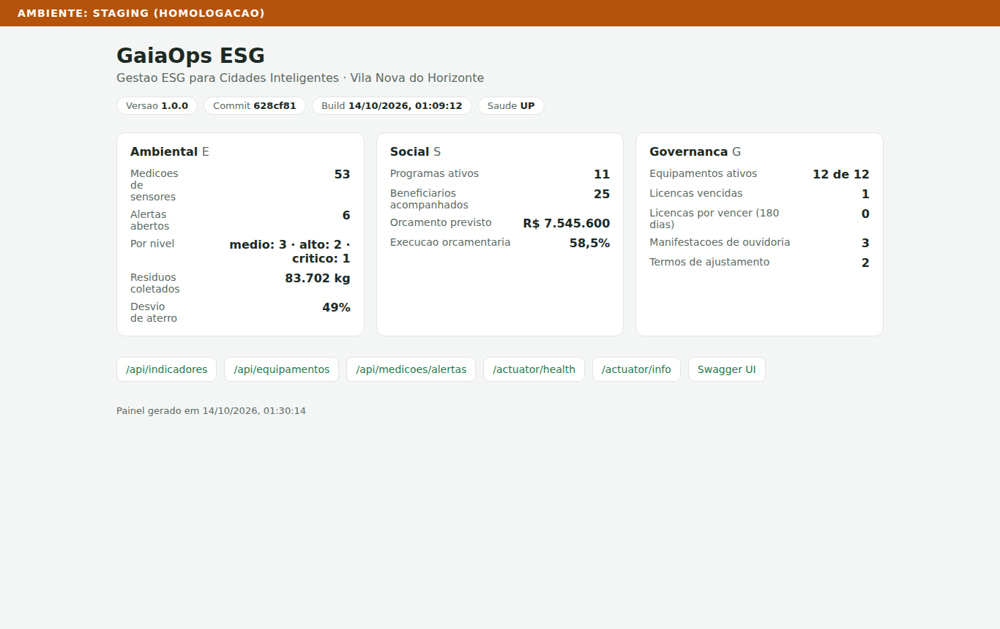

### Swagger UI disponível em staging
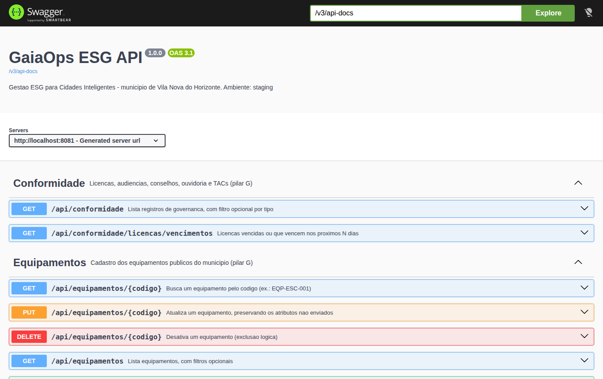

### Ambiente de produção funcionando
Mesmo commit de staging; perfil `prod`, sem o link do Swagger.
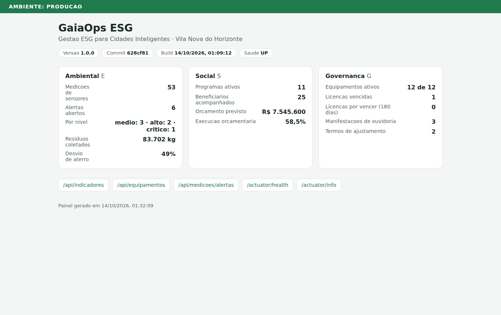

### Imagem publicada no GHCR (tags do commit, `latest`, `staging` e `production`)
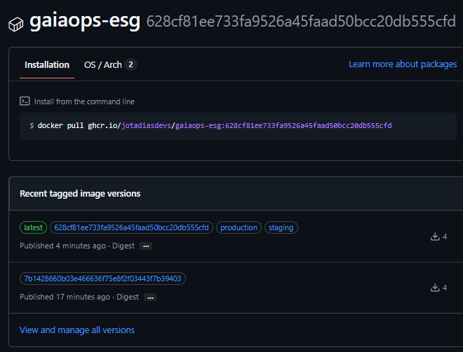

### Deploys por ambiente no GitHub
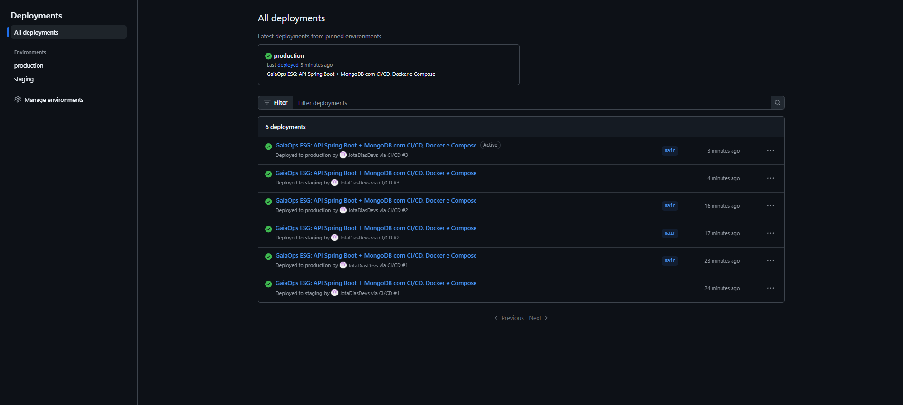

---

## Endpoints da API

| Método | Rota | Descrição |
|---|---|---|
| GET | `/api/indicadores` | Painel ESG dos três pilares |
| GET | `/api/equipamentos` | Lista equipamentos (filtros: `tipo`, `distrito`, `ativo`) |
| GET | `/api/equipamentos/{codigo}` | Busca por código (ex.: `EQP-ESC-001`) |
| POST | `/api/equipamentos` | Cadastra (validação + atributos livres por tipo) |
| PUT | `/api/equipamentos/{codigo}` | Atualiza com `$set`, sem apagar atributos não enviados |
| DELETE | `/api/equipamentos/{codigo}` | Desativa (exclusão lógica) |
| GET | `/api/medicoes` | Telemetria (filtros: `equipamento_id`, `tipo`) |
| GET | `/api/medicoes/alertas` | Leituras com alerta (`nivel`, `somente_abertos`) |
| POST | `/api/medicoes` | Registra leitura e aplica as regras de alerta |
| GET | `/api/residuos` · `/api/residuos/resumo` | Coletas e peso por categoria/destinação |
| GET | `/api/programas-sociais` · `/{codigo}` | Programas sociais |
| GET | `/api/conformidade` · `/licencas/vencimentos` | Governança e licenças vencidas ou a vencer |
| GET | `/actuator/health` · `/actuator/info` | Saúde e versão/ambiente/commit implantado |

---

## Tecnologias utilizadas

| Camada | Tecnologias |
|---|---|
| Linguagem e framework | Java 21, Spring Boot 3.5 (Web, Validation, Data MongoDB, Actuator), springdoc-openapi (Swagger UI) |
| Banco de dados | MongoDB 8.0, com validadores `$jsonSchema` e índices parciais, sparse, multikey, 2dsphere e texto |
| Build | Maven 3.9 (Maven Wrapper) |
| Testes | JUnit 5, Spring MockMvc, Mockito, AssertJ, Testcontainers (MongoDB), JaCoCo |
| Containers | Docker (multi-stage build), Docker Compose |
| CI/CD | GitHub Actions, GitHub Environments (aprovação manual), GitHub Secrets, GitHub Container Registry |
| Scripts e qualidade | Bash (deploy, smoke test, evidências), actionlint, shellcheck, hadolint |
| Documentação | Markdown, Mermaid, python-docx + LibreOffice (geração do PDF) |

---

## Estrutura do repositório

```
gaiaops-esg/
├── .github/
│   ├── workflows/ci-cd.yml        pipeline de CI/CD
│   └── scripts/resumo_testes.py   resumo dos testes no Job Summary
├── deploy/
│   ├── deploy.sh                  sobe um ambiente (staging | production)
│   ├── smoke-test.sh              valida o ambiente após o deploy
│   ├── captura-tela.sh            print da página com Chrome headless
│   ├── coletar-logs.sh            estado e logs dos containers
│   ├── staging.env                configuração de staging (sem segredos)
│   └── production.env             configuração de produção (sem segredos)
├── mongo/init/01-setup.js         validadores, índices e usuário do banco
├── src/main/java/...              código da API (um pacote por funcionalidade)
├── src/main/resources/
│   ├── application*.yml           configuração base + perfis staging e prod
│   ├── seed/*.json                carga inicial (100 documentos da Fase 5)
│   └── static/index.html          página inicial
├── src/test/java/...              testes unitários e de integração
├── docs/                          documentação (PDF), roteiro e prints
├── tools/                         geração do PDF e empacotamento da entrega
├── Dockerfile
├── docker-compose.yml
├── .env.example
└── README.md
```

---

## Checklist de entrega

| Item | OK |
|---|---|
| Projeto compactado em .ZIP com estrutura organizada | ☑ |
| Dockerfile funcional | ☑ |
| docker-compose.yml ou arquivos Kubernetes | ☑ |
| Pipeline com etapas de build, teste e deploy | ☑ |
| README.md com instruções e prints | ☑ |
| Documentação técnica com evidências (PDF ou PPT) | ☑ |
| Deploy realizado nos ambientes staging e produção | ☑ |
